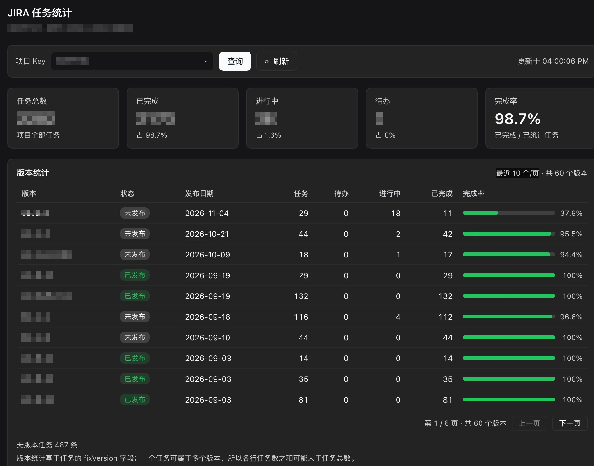
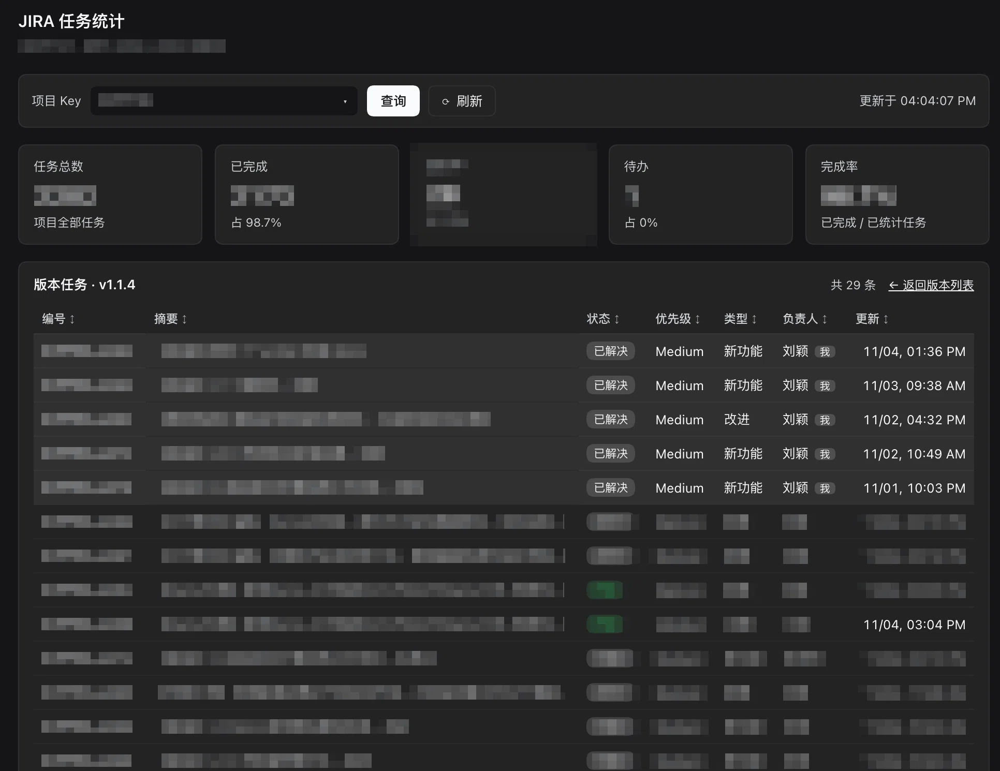

# JIRA Open Tasks Panel (DeepSeek Harness Plugin)

[](LICENSE)

[中文](README.md) · **English**

Shows the current JIRA project's **open / reopened** issues **assigned to the current user** below the DSH composer input, and adds a **JIRA statistics** entry to the left sidebar: open it to switch between existing project keys or type one, then see that project's task statistics and version-statistics list. The JIRA base URL and token are configured in **Settings → JIRA 配置** (the settings dialog's left navigation) (`JIRA_BASE_URL` / `JIRA_API_TOKEN` act as fallback); the project key and JQL are **configured per workspace** and persisted.

> **DSH versions targeted: 0.1.7 and 0.2.x (verified on `0.1.7-rc.2` and `0.2.0-rc.2`; run on Desktop `0.2.1-rc.5`), on both the browser (web profile) and the Desktop app (the Electron-owned desktop profile).**
> The client slots `conversation.input.dock` / `plugins.item` / `settings.section` / `sidebar.panellist` / `main`, the settings service `ctx.configForms` (namespace = profile entry id `jira-tasks`), and the `ctx.effect` / `configForms.whileServed` disposal contracts are unchanged between 0.1.7 and 0.2.0 (verified package by package), so one `lib/` covers both; the 0.1.6-era `settingsScope` / `settings.register` / `settings.plugin.item` APIs are gone and no longer used.
> The package declares its DSH range as `>=0.1.7-rc.2 <0.3.0-0` (`engines.dsh` plus an optional `@deepseek-ai/dsh` peer): since 0.2.0 DSH checks that range **on install and on profile startup**, skipping a mismatched bundle and offering the exact-version `allow-version` exemption in the plugin manager. The peer is marked `optional` so `pnpm` never pulls the whole `@deepseek-ai/dsh` tree into the profile.

## Features

- 📋 Panel shown below the composer in both new and active sessions (aligned with the input width in new sessions)
- 👤 Defaults to the current user (`assignee = currentUser()`) with status `开启 / 重新开启` (Open / Reopened)
- ⚙️ **Settings → JIRA 配置** (left navigation, below Agent presets) edits the base URL and access token (the token is written to the credential store and never sent back to the browser); the same JIRA card stays available in the Plugins panel
- 🟢 The card auto-probes the connection and shows a status light: green = usable, red = unusable, grey = unconfigured; **Test connection** verifies unsaved drafts immediately
- ⚙️ Project key and JQL are saved per workspace; unconfigured workspaces show "unconfigured"
- 🔄 Auto-query on every new session, with a one-click refresh (⟳)
- 🔗 Click an issue to open its JIRA detail in a new tab
- 🎨 Uses DSH theme tokens; adapts to light / dark themes
- 📊 **Left-sidebar JIRA statistics entry**: opens a task-statistics page with one dropdown-capable input — its options are the **project keys already configured in DSH** (saved per workspace), and a custom key can be typed too; it keeps the total issues / completion overview
- 🧾 **Version-statistics list**: versions ordered by release date (newest first), **10 per page with Previous / Next paging**; each row shows release state, release date, issue count, todo / in progress / done and completion
- 🖱️ **Clickable version names**: open that version's JIRA task list — click any header (key / summary / status / priority / type / assignee / updated) to sort, click again to reverse; **your own issues are listed first by default**, the rest by update time (newest first); issue keys open JIRA in a new tab
- 💾 The statistics page remembers the last project key (`dsh.jiraTasks.stats.v1`); on first open it defaults to the project key configured in the current workspace's panel

## Install

Published to npm. For the **browser (web profile)**:

```bash
dsh plugin --profile web add dsh-jira-tasks
```

Or straight from GitHub (the repository root is the package directory; `lib/` is prebuilt):

```bash
dsh plugin --profile web add github:liu3734/jira-tasks-dsh-plugin
```

**Restart DSH** to activate.

### Desktop app (DeepSeek Harness.app)

The Desktop app does not use the `web` profile; it boots the Electron-owned **`desktop` profile** (`~/.dsh/profiles/desktop/`). That profile name is reserved: an npm-installed `dsh` **refuses** both boot and plugin operations for `--profile desktop` (`profile "desktop" is managed exclusively by the Electron application`). Use the Desktop-provided command instead:

1. Open the Desktop app once (it initializes the desktop profile), then **quit it completely**
2. In the app menu, open **Manage dsh Command** → Install (puts the Desktop's own `dsh` on your PATH)
3. Install the plugin:

   ```bash
   dsh plugin --profile desktop add dsh-jira-tasks
   ```

4. Confirm `"dsh-jira-tasks"` is listed in `dsh.profile.bundles` of `~/.dsh/profiles/desktop/package.json`, then start the Desktop app

> The renderer's origin is `dsh-app://app`. Electron forwards every non-static request to the local Host with its cookie, so the plugin's absolute-path `fetch("/jira/api/search")` keeps working; `target="_blank"` issue links are handed to the system browser. The project key / JQL live in that origin's localStorage, so **they are separate from the browser configuration at `http://127.0.0.1:<port>`** — configure each surface once.

> **Nothing shows up? Check `dsh.profile.bundles` first.** DSH mounts this package as a profile layer only when `"dsh-jira-tasks"` is listed in `dsh.profile.bundles` of that profile's `package.json` (`~/.dsh/profiles/web/package.json` or `~/.dsh/profiles/desktop/package.json`); being in `dependencies` alone is not enough — the startup log then prints `patch: entry "jira-tasks" not found` and the plugin silently never loads. `dsh plugin --profile <name> add` normally appends that row, but it will not re-append when the package is already a dependency; add `"dsh-jira-tasks"` to `dsh.profile.bundles` by hand.

> Using GitHub Packages instead: configure `@liu3734:registry=https://npm.pkg.github.com/` plus a read token in the profile's `.npmrc`, then run `dsh plugin --profile web add @liu3734/dsh-jira-tasks`.

<details>
<summary>Manual install (without npm)</summary>

1. Copy this repository (its root is the package directory) into the profile's `packages/dsh-jira-tasks/` (`~/.dsh/profiles/web/` for the browser, `~/.dsh/profiles/desktop/` for the Desktop app; skip `.git/`)
2. Edit that profile's `package.json`:
   - Add to `dependencies`: `"dsh-jira-tasks": "file:./packages/dsh-jira-tasks"`
   - Append to `dsh.profile.bundles`: `"dsh-jira-tasks"`
3. Run `pnpm install` in the profile directory
4. Restart DSH (the Desktop app must be fully quit and reopened)

> Note: `pnpm install` **copies** the package into `node_modules/` (not a symlink) — after editing sources, sync `node_modules/dsh-jira-tasks` or re-run install.
</details>

<details>
<summary>Dynamic plugin (temporary, lost on restart)</summary>

In a DSH session, use the Cordis tools: `cordis_define` (`kind: new`, `idPrefix: "jira"`, sources in `plugin/host.js` / `plugin/client.js`) → `cordis_run` to activate. Dynamic plugins live only in process memory and **disappear on restart** — for trial use only. The dynamic build contains **only the composer task panel**, not the left-sidebar statistics page (that page relies on the full client-module load order and the `sidebar.panellist` / `main` slots of a profile bundle).
</details>

## Configuration

### 1. JIRA base URL and token

Open **Settings → JIRA 配置** (the last item in the left navigation, below Agent presets; the JIRA card in the Plugins panel is the same form) and fill in:

- **JIRA base URL**: e.g. `http://jira.example.com/` (written to this plugin entry's `Config.baseUrl` — the `jira-tasks` row in the profile's `cordis.patch.yml` — and read back by the form; a host-refused write now surfaces as an error instead of failing silently)
- **Access token / PAT**: written to the credential store (`$DSH_HOME/.credentials.yaml`) under the plugin-owned ref `JIRA_TASKS_TOKEN`; the browser only ever sees "configured", never the token itself

Leaving the token blank on save keeps the existing one; clearing the address on save removes the override and falls back to the credential store / environment. Auth is auto-detected: tokens containing `:` use Basic, otherwise Bearer (JIRA PAT).

> **The settings-page token takes precedence over the environment.** When the environment that launched DSH already defines `JIRA_API_TOKEN` (a Windows *user-level* variable counts), the card is still editable: it stores the token in its own ref `JIRA_TASKS_TOKEN`, which DSH accepts (it only refuses to write a ref the launching environment shadows), and the Host resolves tokens in this order:
>
> ```
> JIRA_TASKS_TOKEN (settings card) > JIRA_API_TOKEN > JIRA_TOKEN
> ```
>
> Click **Clear settings token** in the card to fall back to the environment variable again.

#### Connection test

The card's footer carries a status light and a **Test connection** button:

- Opening the card **auto-probes** once (against JIRA `/rest/api/2/myself`), and saving re-probes
- **Green** = address and token work (the current user is shown); **red** = unusable (JIRA's reason, e.g. 401, is shown); **grey** = address or token not configured
- **Test connection** probes what is currently in the fields, saved or not, so you can check before saving

Environment variables / credentials still work as a **fallback** (used when the settings card leaves `baseUrl` empty), hot-reloaded without a restart. Address precedence is `Config.baseUrl` > `JIRA_BASE_URL` > `JIRA_URL`, and `JIRA_BASE_URL` may live in the launching environment or in `.credentials.yaml` — note that a stale record (e.g. an old domain left in the credential file) becomes effective again as soon as the settings page clears the address:

```yaml
JIRA_BASE_URL: "http://jira.example.com/"
JIRA_API_TOKEN: "<PAT or user:token>"
```

- Base URL aliases: `JIRA_BASE_URL` / `JIRA_URL`
- Token resolution order: `JIRA_TASKS_TOKEN` (written by the settings card) → `JIRA_API_TOKEN` → `JIRA_TOKEN`; the first match wins

### 2. Project key and JQL (per workspace)

- Click **⚙** on the panel header to open settings (the form shows the target workspace)
- **Project key**: e.g. `HCPFYH1` — saved and queried immediately; auto-loaded for new sessions in that workspace
- **JQL**: leave empty for the default, or write a custom JQL where `{projectKey}` (or `{key}`) is replaced by the project key

Default query:

```jql
project = "{projectKey}" AND status in ("开启", "重新开启") AND assignee = currentUser() ORDER BY updated DESC
```

> The status names follow the Chinese workflow (`开启`/`重新开启`). For English statuses (Open/Reopened), set a custom JQL in ⚙.

## Task statistics (left-sidebar entry)

Click the **JIRA statistics** icon in the left sidebar (the same column as Plugins / scheduled tasks / sticky notes, slot `sidebar.panellist`) and the main column opens the statistics page (`main` panel, key `jira-stats`). The page is global: it is not bound to a session or workspace.

- **One dropdown-capable input**: its options are the **project keys already configured in DSH** — the `projectKey` each workspace saved in the composer panel's ⚙ (labelled with the workspace path's last segment) plus the statistics page's last-viewed key. It does **not** fetch the whole JIRA project list.
- **Switch**: click the ▾ at the right of the input to list configured keys; move with ↑/↓, then press Enter or click to query. Typing filters by key or workspace name.
- **Custom key**: type a project key (e.g. `HCPFYH1`) and press Enter or click **Query**; JIRA project keys are upper-cased automatically.
- **What it shows**:
  - summary cards: total issues, done, in progress, todo, completion rate
  - **version-statistics list**: versions ordered by release date (newest first; versions without a date and task-only versions come last), **10 versions per page** with Previous / Next paging and a "Page X / Y · N versions" label; each row shows release state, release date, issue count, todo / in progress / done and completion
  - the number of issues without a version is listed separately
- **Version task list**: click a version name to open that version's JIRA issues (Host query `project = KEY AND fixVersion = "version"`, fields `summary,status,priority,issuetype,assignee,updated`, at most 5,000 issues); click any header (key / summary / status / priority / type / assignee / updated) to toggle ascending / descending, with **your own issues first by default** and the rest by update time descending; "← Back to versions" returns to the list, and issue keys open JIRA in a new tab
- **Data scope**: the Host pages through the project's issues (`JQL: project = "<KEY>" ORDER BY created ASC`, `fields=status,fixVersions`, 1000 per page) and returns one aggregated payload; **sub-tasks are included** (`project = ...` does not filter issue type). It scans at most 20,000 issues and runs at most 120 seconds per request; either limit shows "only the first N issues" at the top.
- **Cache-first entry**: opening the page or switching back to a previously viewed project renders that session's cached result immediately and then refreshes **silently in the background** — no full-page loading flash (only the very first load of an uncached project shows the loading state).
- **Refresh**: the **⟳ Refresh** button refreshes in the background without interrupting the current content and without switching to the full-page loading state; only the button spins (⟳ → spinner + "刷新中…") and returns to normal when done; a failed refresh keeps the old content and shows a notice below the toolbar.
- **Switching projects**: a cached project renders instantly then refreshes silently; an uncached project shows the loading state.
- Read-only: the page never modifies JIRA, and it reuses the **Settings → JIRA 配置** address/token, so no extra configuration is needed.
- The page remembers the last project key (`localStorage dsh.jiraTasks.stats.v1`) and re-queries it on the next open; before the first open it defaults to the project key configured for the current workspace in the composer panel.

**Statistics page (overview + version list, 10 versions per page):**



**Click a version name to open its task list: sortable headers, your own issues first by default:**



> Query time scales with project size: a few thousand issues usually take a few seconds (JIRA search returns 1000 per page). Status classification follows JIRA's `statusCategory` (for example "Closed"/"Resolved" normally count as done); if a workflow maps a status to the done category, the page reports it as such.

## Compatibility & verification

| Dimension | Coverage |
|---|---|
| DSH versions | `0.1.7-rc.2` and `0.2.0-rc.2` (verified), Desktop `0.2.1-rc.5` (run); declared range `>=0.1.7-rc.2 <0.3.0-0` — the 0.1.7 and 0.2.x lines, excluding 0.3.0 and its prereleases |
| Surfaces | Browser (`dsh web` / web profile) and the Desktop app (Electron, desktop profile, renderer origin `dsh-app://app`) |
| Host APIs | `Config` / `webServer.register` / `subprocess.spawn` / `credentials.resolve` / `settings.configure` — signatures unchanged from 0.1.7 to 0.2.0; routes `/jira/api/search`, `/jira/api/test`, `/jira/api/stats`, `/jira/api/version-issues` |
| Client APIs | `window.__ModuleLoader__.load`, `slots.inject/register`, `configForms.get/whileServed`, `remote.credentials`, slots `conversation.input.dock` / `plugins.item` / `settings.section` / `sidebar.panellist` / `main` — contracts unchanged from 0.1.7 to 0.2.0 (`sidebar.panellist` (list, reads `id/order/label`) and `main` (keyed) checked against the 0.1.7 sidebar / layout package declarations; `ownerProps {size, active}` checked against a live Desktop 0.2.1-rc.5 instance) |

How it was verified (a throwaway `DSH_HOME`, the user's own profile untouched):

```bash
# Boot the target dsh in isolation; the profile's dsh.profile.bundles lists dsh-jira-tasks
DSH_HOME=/tmp/dsh-check node <dsh-0.2.0-rc.2>/lib/bin.js --profile web --no-open --port 19399

curl -sX POST http://127.0.0.1:19399/jira/api/test   -d '{}'                      # connectivity / auth
curl -sX POST http://127.0.0.1:19399/jira/api/search -d '{"projectKey":"<KEY>"}'  # issue query
curl -sX POST http://127.0.0.1:19399/jira/api/stats    -d '{"projectKey":"<KEY>"}'    # task + version statistics
curl -sX POST http://127.0.0.1:19399/jira/api/version-issues -d '{"projectKey":"<KEY>","versionName":"<version>"}'  # version task list
curl -s "http://127.0.0.1:19399/?token=<token from the startup log>" | grep -o dsh-jira-tasks  # client bundle in __DSH_BOOT__
```

For the Desktop app additionally confirm the client bundle appears in the app's `Code Cache` (the renderer loaded and executed it) and that `dsh.jiraTasks.config.v1` exists in its `localStorage` (the panel works and writes per workspace).

## Uninstall

```bash
dsh plugin --profile web remove dsh-jira-tasks        # browser
dsh plugin --profile desktop remove dsh-jira-tasks    # Desktop app (needs the Desktop-provided dsh)
```

## Troubleshooting

<details>
<summary>Clicking a version shows "interface ... returned an empty response (HTTP 405)"</summary>

This means the **browser already runs the new client bundle while the Host process still runs the old plugin** (a page refresh only reloads the client JS, not the Host). Fully quit and reopen the app:

- macOS: `Cmd+Q` or the app menu's Quit (closing the window with the red button does not end the process)
- Browser (web profile): restart `dsh web`

After the restart `/jira/api/version-issues` returns 200; you can also check with `curl -X POST http://127.0.0.1:<port>/jira/api/version-issues -d '{}'` that it is no longer 405.
</details>

<details>
<summary>Panel shows "query failed"</summary>

| Message | Fix |
|---|---|
| JIRA base URL not configured | Address missing — see "Configuration 1" above |
| JIRA token not configured | Token missing — see "Configuration 1" above |
| 401 … | Invalid token or wrong auth scheme; verify with `curl -H "Authorization: Bearer <token>" <base>/rest/api/2/myself` |
| Cannot parse JIRA response | Network / proxy issue, curl produced no output |
</details>

<details>
<summary>Can the settings card override the token from the environment?</summary>

**Yes.** The card stores the token under the plugin-owned ref `JIRA_TASKS_TOKEN` instead of writing the environment's `JIRA_API_TOKEN`. DSH only refuses to write a ref the launching environment *shadows*, so its own ref is always writable: even with `JIRA_API_TOKEN` exported by the shell or the OS, the field accepts input, the save succeeds, and the Host prefers it:

```
JIRA_TASKS_TOKEN (settings card) > JIRA_API_TOKEN > JIRA_TOKEN
```

- The card names the effective source: with a saved token it says "overrides environment variable JIRA_API_TOKEN"; without one it says "currently using environment variable JIRA_API_TOKEN — fill in and save to override"
- Saving re-probes the connection; **Clear settings token (fall back to environment)** removes the override
- The one remaining case that reports `is supplied read-only by the launching environment` is someone exporting `JIRA_TASKS_TOKEN` itself — that ref really is read-only then; remove it (Windows: System Properties → Environment Variables, or PowerShell `[Environment]::SetEnvironmentVariable('JIRA_TASKS_TOKEN', $null, 'User')`) and restart DSH
</details>

<details>
<summary>Panel does not appear</summary>

- Make sure it is installed and DSH was **restarted** (the Desktop app must be fully quit and reopened); in new sessions the panel sits below the input
- Check `dsh.profile.bundles` in the right profile: `~/.dsh/profiles/web/package.json` for the browser, **`~/.dsh/profiles/desktop/package.json` for the Desktop app** (the most common cause of a silent no-show — see the Install note; that profile can only be edited with the Desktop-provided `dsh`)
- Check the DSH startup log: `patch: entry "jira-tasks" not found` means the profile layer was never composed; `Plugin dsh-jira-tasks@<version> is incompatible with dsh <runtime>` means the running version falls outside the declared `>=0.1.7-rc.2 <0.3.0-0` range, so the bundle is skipped (follow the message, using `dsh plugin allow-version` or the plugin manager, to grant the exact-version exemption); `webserver: duplicate exact route` means a route was registered twice (the plugin releases its routes through `ctx.effect`, so this points at a second copy)
- A console error `client-modules: could not load "dsh-jira-tasks"` means `/plugins/dsh-jira-tasks/client.js` was not served — confirm `exports["./client"]` resolves to the built `lib/client.js`
- The sidebar shows no **JIRA statistics** icon: the bundle must be re-loaded with a fresh JavaScript generation — fully quit and reopen the Desktop app (or restart `dsh web`); also check the console for `slot entry crashed in 'main'` or `client-modules: could not load "dsh-jira-tasks"`, and confirm `dsh.client.inject` lists the layout/sidebar client packages so the plugin activates after those slots exist
- The Desktop panel says "unconfigured" although you configured it: project key / JQL are stored per **origin**, so `dsh-app://app` (the built-in window) and `http://127.0.0.1:<port>` (a browser) hold two independent configurations
</details>

## Architecture & Implementation Details

<details>
<summary>Expand</summary>

```
┌────────────── Browser (Client) ──────────────┐      ┌─────────────── Host ───────────────┐
│ conversation.input.dock (both states)        │      │ webServer route /jira/api/search   │
│ CSS order:99 -> below the input, full width  │      │ entry Config.baseUrl (volatile)    │
│ on mount/refresh: fetch POST                 │      │ credentials.resolve(TOKEN_REFS)    │
│ render: list / error / unconfigured          │      │ subprocess.spawn(curl ...)         │
│ localStorage: per-workspace key/JQL          │      │ parse stdout JSON                  │
│ plugins.item (Plugins panel card)            │      │ return {ok, issues}                │
│ settings.section (Settings nav page)         │      │                                    │
├──────────────────────────────────────────────┤      ├────────────────────────────────────┤
│ sidebar.panellist (left-rail icon row)       │      │ /jira/api/stats -> paged scan and  │
│   click -> main (key: jira-stats)            │      │   aggregate overview + version     │
│ main (page; picker reads local config)       │      │   + version tasks (sortable)       │
└──────────────────────────────────────────────┘      └────────────────────────────────────┘

- **Host**: declares the entry's own `Config` (`baseUrl`, `volatile` — since DSH 0.1.5 a settings page is built from it; `settings.configure({ auto: false }, ctx.fiber)` turns the auto-generated page off and hands its disposer back to `ctx.effect`) plus `webServer` routes `POST /jira/api/search`, `POST /jira/api/test`, `POST /jira/api/stats` and `POST /jira/api/version-issues`, each wrapped in its own `ctx.effect` (a reload otherwise hits "duplicate route" and fails activation; non-POST requests get 405); the token comes from the `credentials` service resolved in the order `JIRA_TASKS_TOKEN` (written by the Settings card) → `JIRA_API_TOKEN` → `JIRA_TOKEN` (`$DSH_HOME/.credentials.yaml` / environment, hot-reloaded), so a saved card token overrides the environment; queries run through `subprocess` spawning `curl` directly, with the auth header passed via stdin (`--config -`) so the token never appears in argv.
- **Statistics page (sidebar entry)**: two registrations — `sidebar.panellist` (`id: "jira-stats"`, `order: 30`, `label: "JIRA 统计"`, drawing its own 16px SVG icon from the owner props `size` / `active`) and `main` (keyed slot, `key: "jira-stats"`). The `sidebar.panellist` id is the dispatch key for `main`: clicking the rail icon makes the host swap the central panel. Both live inside `slots.inject`, so they re-attach whenever the slot declaration appears or disappears. The page renders only the Host-aggregated payload, so the browser never folds thousands of issues itself.
- **Client**: a standard `window.__ModuleLoader__.load({ id, factory })` web bundle requiring only `"react"`; registers **only `conversation.input.dock`** (`order: 10`) — that seat renders in both new and active sessions and is a full-width row of `composerStack` (`flex-direction: column`), where the panel's own CSS `order: 99` places it below the input card at the card's width. `conversation.composer.dock` is deliberately NOT used: in 0.1.7 and 0.2.0 alike that seat renders into InputBar's `.dock` **row**, side by side with the context meter, so a full-width panel there gets its right-hand content covered by the meter. The address/token form comes from `ctx.configForms.get("jira-tasks")` and the token is written through `remote.credentials` to `JIRA_TASKS_TOKEN`; `configForms.whileServed` keeps it hidden when the host serves no such namespace. It is registered in **two places**: the Plugins-panel card `plugins.item` (`id: "jira-tasks"`, `order: 41`) and a Settings-navigation section `settings.section` (`id: "jira-tasks"`, `order: 30` — above Agent presets' 20, so it sits below it; `label: "JIRA 配置"`; ids outside the shell's `navIcon` allow-list fall back to the default gear icon). Both share one `JiraSettingsPage`, whose outer container is chosen by the external `variant: "page"` prop (`li.jt-set-card` card vs `div.jt-set-page` page) while the field block is the same array. The card's `summary` view is rendered by a dispatcher that calls **no hooks**, while the form lives in a separate `JiraSettingsPage`, so flipping `view` on one mounted instance never changes its hook count.
- **Why not the `shell` service**: `shell` wraps commands with `sandbox-exec`, which is broken on some macOS versions (`sandbox_apply: Operation not permitted`); `subprocess` is the raw process seam without this issue.
- **Why the Desktop app needs no code branch**: its Host is the same DSH as the web profile (same `@deepseek-ai/dsh-web-app` + `dsh-host-webserver`); only the renderer origin differs (`dsh-app://app`), and Electron's `protocol.handle` forwards every non-static request to the local Host with its cookie, so both `fetch("/jira/api/*")` and `/plugins/...` work. `http(s)` `target="_blank"` links are handed to the system browser by the main window's `setWindowOpenHandler`. The only difference that matters is origin-scoped localStorage, so each surface keeps its own project key / JQL.
- **One registration covers both states**: `conversation.input.dock` renders whenever a session and its input exist, so new and active sessions need no separate registrations (the older `composer.dock` + blank-session de-duplication was both unnecessary under 0.1.7 and the cause of the meter-row collision).

**Differences from the dynamic version**

| Aspect | Dynamic plugin | Persistent install (this package) |
|---|---|---|
| Persistence | Lost on restart | Survives restart |
| Client→Host | `host.call` / `harness.handle` | `webServer` route + `fetch` |
| Client bundle | Injected per session | `/plugins/dsh-jira-tasks/client.js` |
| Config / credentials | Env / `.credentials.yaml` only (no Settings card) | Settings nav page + Plugins-panel card + same `.credentials.yaml` fallback |
</details>

## License

MIT
