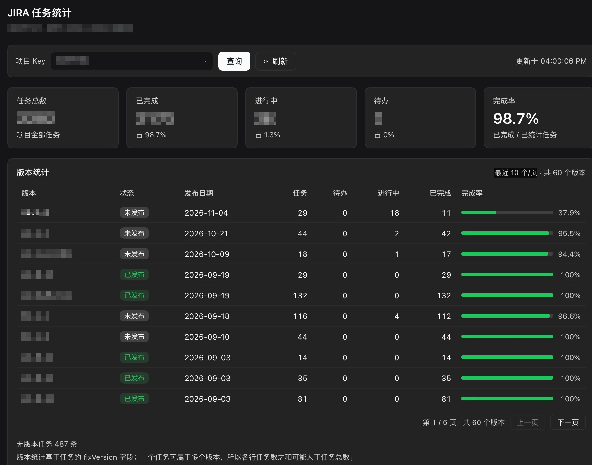
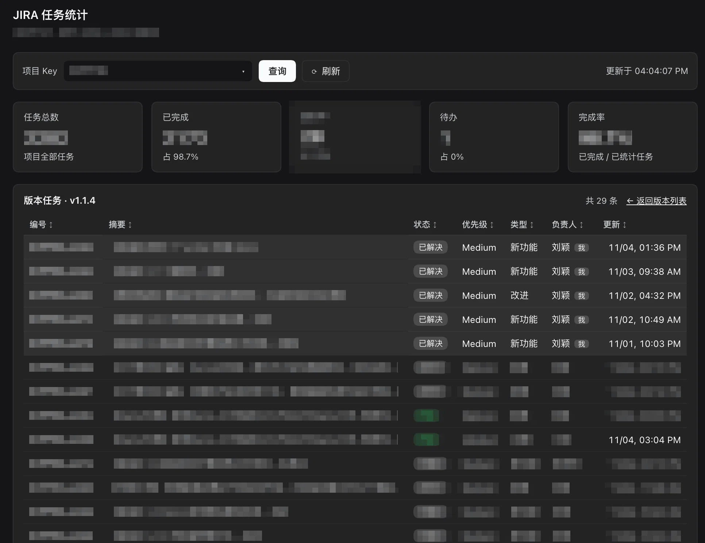

# JIRA 任务面板（DeepSeek Harness 插件）

[](LICENSE)

**中文** · [English](README.en.md)

把 JIRA 搬进 DeepSeek Harness：**输入框下方**直接显示当前项目里指派给你的「开启 / 重新开启」任务，**左侧栏**多一个「JIRA 统计」入口，看项目进度、版本进度和版本内的任务清单。只读，不改 JIRA。


---

## 快速开始（3 步）

1. **安装插件**（浏览器 / web 端）

   ```bash
   dsh plugin --profile web add dsh-jira-tasks
   ```

   装完**重启 DSH**。

2. **填 JIRA 地址与令牌**：设置 → **JIRA 配置** → 填写地址和访问令牌 → 看到**绿灯**即连通。

   

3. **填项目 Key**：点面板标题右侧 **⚙**，填写项目编号（如 `HCPFYH1`），保存即查询。

---

## 界面

| 位置 | 是什么 | 能做什么 |
|---|---|---|
| 输入框下方 | 我的任务面板 | 看本人在「开启 / 重新开启」里的任务，点开进 JIRA |
| 左侧栏「JIRA 统计」 | 项目统计页 | 切项目、看总量与完成率、按版本看进度 |
| 版本列表 → 版本名 | 版本任务列表 | 看该版本的所有任务，点表头排序，本人排最前 |

### 1. 我的任务面板

新会话和正在聊的会话都会显示，默认**折叠**成一行标题 + 任务数：

- 点标题展开 / 收起，查看列表（按更新时间倒序，最多 50 条）
- 每条带**状态徽章**（新建 / 进行中 / 其他）、优先级和类型标签
- 点 **⟳** 立即刷新；点任务在**新标签页**打开 JIRA 详情
- 点 **⚙** 改项目 Key 和 JQL


### 2. 任务统计页

左侧栏点 **JIRA 统计** 打开，与会话无关，是全局页面。



- 顶部**一个输入框**：下拉列出你已配置过的项目 Key（标注来自哪个工作区），也可直接输入项目编号回车查询
- **概览卡片**：任务总数、已完成、进行中、待办、完成率
- **版本统计**：按发布日期倒序，每页 10 个版本，底部「上一页 / 下一页」；每行含发布状态、发布日期、任务数、待办 / 进行中 / 已完成与完成率
- **⟳ 刷新**在后台更新，不打断当前内容、不整页闪白
- 切回看过的项目**先用缓存秒开**，再静默刷新
- 自动记住上次看的项目，下次打开直接回来

### 3. 版本任务列表

点任意版本名进入。



- **点表头排序**：编号 / 摘要 / 状态 / 优先级 / 类型 / 负责人 / 更新，再点一次切升降序
- **默认本人任务排最前**，其余按更新时间倒序
- 任务编号可点，在新标签页打开 JIRA 详情
- 「← 返回版本列表」回到上一级

---

## 配置

全部配置都在 **设置 → JIRA 配置**（左侧导航，在「Agent 预设」下面）里。插件面板里的同一张卡片是同一个表单，两处都行。

### JIRA 地址与令牌

| 项 | 填什么 | 存在哪 |
|---|---|---|
| JIRA 地址 | 如 `http://jira.example.com/` | 插件配置项，界面可回读 |
| 访问令牌 / PAT | JIRA 个人访问令牌 | 凭据存储，前端只显示「已配置」 |

- 认证方式自动识别：令牌含 `:` 用 Basic，否则用 Bearer
- 留空保存 = 保持原值不变；想退回环境变量，点「清除设置页令牌」
- 地址留空保存 = 清除设置项，回退到环境变量 / 凭据文件里的 `JIRA_BASE_URL`

**连接状态灯**（卡片底部）：

| 灯 | 含义 |
|---|---|
| 🟢 绿 | 地址与令牌可用，并显示当前登录用户 |
| 🔴 红 | 不可用，显示 JIRA 返回的原因（如 401） |
| ⚪ 灰 | 地址或令牌未配置 |

打开卡片会自动探测一次，保存后自动重测；点 **测试连接** 可以用**还没保存的输入**立即验证。

### 项目 Key 与 JQL（按工作区保存）

- **项目 Key**：如 `HCPFYH1`，保存后立即查询，该工作区的新会话自动加载
- **JQL**：留空走默认查询，也可自定义，`{projectKey}` / `{key}` 会被替换成项目 Key

默认查询（中文工作流状态名）：

```jql
project = "{projectKey}" AND status in ("开启", "重新开启") AND assignee = currentUser() ORDER BY updated DESC
```

> 用英文状态（Open / Reopened）的团队，在 ⚙ 里填一段自定义 JQL 即可。

### 用环境变量（可选）

不想在界面里填令牌，也可以用启动环境或 `~/.dsh/.credentials.yaml` 里的：

```yaml
JIRA_BASE_URL: "http://jira.example.com/"
JIRA_API_TOKEN: "<PAT 或 user:token>"
```

优先级：

- 地址：设置页地址 > `JIRA_BASE_URL` > `JIRA_URL`
- 令牌：设置页令牌 > `JIRA_API_TOKEN` > `JIRA_TOKEN`

**设置页令牌优先于环境变量**，环境里已经导出 `JIRA_API_TOKEN` 也能在界面覆盖它。

---

## 桌面端（DeepSeek Harness.app）

桌面端使用独立的 `desktop` profile，且必须用桌面端自带的命令（npm 全局装的 `dsh` 会拒绝操作该 profile）：

1. 先打开一次桌面端（由应用初始化 profile），然后**完全退出**（macOS 用 `Cmd+Q`，关窗口不算退出）
2. 菜单 → **管理 dsh 命令 / Manage dsh Command** → Install，把桌面端自带 `dsh` 装进 PATH
3. 安装插件：

   ```bash
   dsh plugin --profile desktop add dsh-jira-tasks
   ```

4. 重新打开桌面端

> 桌面端与浏览器**配置不互通**：项目 Key / JQL 按页面来源分开存，两边各配一次即可。JIRA 地址与令牌来自同一份设置，无需重复配置。

---

## 升级与卸载

```bash
# 升级
dsh plugin --profile web add dsh-jira-tasks@latest

# 卸载（浏览器 / 桌面端）
dsh plugin --profile web remove dsh-jira-tasks
dsh plugin --profile desktop remove dsh-jira-tasks
```

升级后**重启 DSH**。

---

## 常见问题

<details>
<summary>装完后看不到面板</summary>

- 确认已**重启 DSH**（桌面端要完全退出再打开）
- 确认 profile 配置里 `dsh.profile.bundles` 包含 `"dsh-jira-tasks"`（浏览器：`~/.dsh/profiles/web/package.json`；桌面端：`~/.dsh/profiles/desktop/package.json`）。这是最常见的漏装原因，手动追加这一项即可
- DSH 版本需在 `0.1.7` ~ `0.2.x` 范围内，超出会被跳过
- 桌面端显示「未配置」但记得配过：桌面端与浏览器的项目配置各存一份，需要各配一次
</details>

<details>
<summary>面板显示「查询失败」</summary>

| 提示 | 处理 |
|---|---|
| 未设置项目 Key | 点标题右侧 ⚙ 填项目 Key |
| 未配置 JIRA 地址 | 去「设置 → JIRA 配置」填地址 |
| 未配置 JIRA 令牌 | 去「设置 → JIRA 配置」填令牌 |
| 401 … | 令牌无效或认证方式不对，重填令牌并用「测试连接」验证 |
| 无法解析 JIRA 响应 | 网络 / 代理问题，检查机器能否访问 JIRA |
</details>

<details>
<summary>点版本名提示「接口返回空响应（HTTP 405）」</summary>

页面已更新但后台进程还在跑旧插件。**完全退出 DSH 再打开**即可（刷新网页不算）。
</details>

<details>
<summary>统计数字和 JIRA 里不一致</summary>

- 状态归属沿用 JIRA 的 `statusCategory`：工作流里被归为「完成」分类的状态都会算成已完成
- 统计包含子任务
- 单次最多统计 20000 条任务，超出会在页面顶部提示「仅统计前 N 条」
</details>

<details>
<summary>不想用 npm，手动安装</summary>

1. 把本仓库复制为 profile 内的 `packages/dsh-jira-tasks/`（可忽略 `.git/`）
2. 编辑该 profile 的 `package.json`：`dependencies` 加 `"dsh-jira-tasks": "file:./packages/dsh-jira-tasks"`，`dsh.profile.bundles` 加 `"dsh-jira-tasks"`
3. 在 profile 目录执行 `pnpm install`，然后重启 DSH
</details>

---

## 兼容性

| 维度 | 覆盖 |
|---|---|
| DSH 版本 | `0.1.7` ~ `0.2.x`（不含 `0.3.0` 及其预发布） |
| 运行形态 | 浏览器（`dsh web`）、桌面端 DeepSeek Harness.app（Electron） |
| 主题 | 浅色 / 深色自适应 |
| JIRA | Server / Data Center REST API v2，PAT（Bearer）或 Basic 认证 |

## License

MIT
